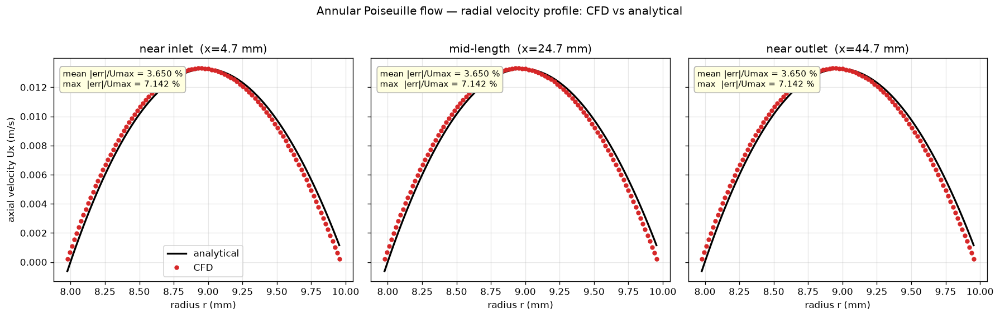
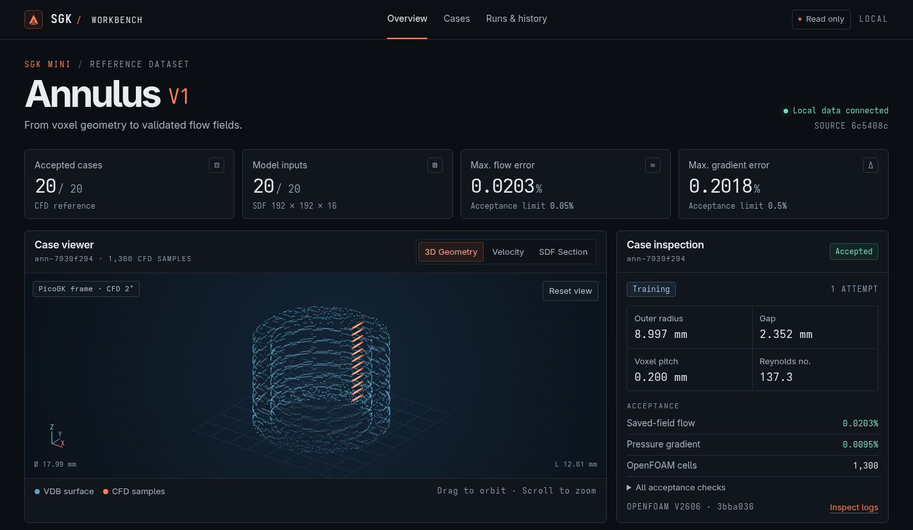

# SGK Mini

SGK Mini checks the Space Generative Kernel (SGK) workflow on one problem:
laminar water flow through the gap between two concentric cylinders. PicoGK
builds the voxel geometry. OpenFOAM uses the recovered dimensions to solve the
flow, which we check against the analytical solution. The CFD results then
serve as training data for models that predict the velocity field.

## Current status

All **20 CFD cases** passed the acceptance checks and were converted to model
inputs. The split is 11 training, 4 validation, 3 test and 2 stress cases.

### Training results

The multilayer perceptron (MLP) uses the annulus parameters. The Fourier neural
operator (FNO) also uses a 2D signed distance field. Both trained for 300 epochs
on the same 11 cases and passed every threshold on the four validation cases.
Errors are the worst across those four cases, measured against OpenFOAM.

| Metric | MLP | FNO |
| --- | ---: | ---: |
| Velocity field error | 0.149% | 0.067% |
| Near-wall velocity error | 0.233% | 0.192% |
| Sampled peak velocity error | 0.153% | 0.077% |
| Flow rate error | 0.024% | 0.018% |
| Pressure gradient error | 0.191% | 0.040% |
| Training time | 3.48 s (CPU) | 36.40 s (GPU) |

The test and stress cases are still reserved for final evaluation. Next we
will try the geometry-informed neural operator (GINO) on one training case,
from VDB surface samples to a reloaded checkpoint.

See the [training runs and thresholds](training/README.md) and the
[batch report](pipeline/reports/batch-v1.md).

## Quick start

From the repository root, with the **.NET 9 SDK** and **Python 3** installed,
follow the [Linux PicoGK setup](validation/README.md#linux-picogk-setup),
then build and compare the generated analytical records with the committed
reference records:

```bash
python3 scripts/check_analytic.py
```

The geometry step opens the PicoGK viewer and closes it when the task ends.
It writes the VDB, extracted geometry features, and analytical flow record to
`output/`. To supply different case parameters, use the
[geometry command options](validation/README.md#geometry-command-options).

To include the CFD comparison, install OpenFOAM v2606, create a Python
environment for NumPy and Matplotlib, and point to OpenFOAM's environment
script:

```bash
python3 -m venv "$HOME/data/venvs/sgk-mini"
"$HOME/data/venvs/sgk-mini/bin/python" -m pip install numpy matplotlib
FOAM_BASHRC=/path/to/OpenFOAM-v2606/etc/bashrc \
  python3 scripts/check_analytic.py --with-cfd
```

NumPy is used by the numerical checks. Matplotlib lets the CFD runner
regenerate the figures. See the [validation guide](validation/README.md)
for the individual commands and environment overrides.

## Reference benchmark

Water flows through a concentric annulus with nominal radii of 8 and 10 mm,
a length of 50 mm, and a prescribed flow rate of 1 mL/s (Re ≈ 35).
The geometry uses 0.2 mm voxels. The OpenFOAM case uses a 2° periodic wedge
with **58 axial × 100 radial × 1 tangential cell**.



In the reference run, the mean and maximum profile errors relative to the
analytical peak speed were **0.0046%** and **0.0071%**. The flow-rate error
was **0.0203%**, consistent with the measured area deficit of the finite
wedge. See the [full metrics, assumptions, and figures](validation/README.md#cfd-cross-check-openfoam).

## Workbench

The [workbench](workbench/README.md) shows the geometry, CFD samples, case
checks and training runs.



## Repository guide

| Path | Contents |
| --- | --- |
| [src/SGK.Geometry/](src/SGK.Geometry/) | C# geometry generation, voxel sampling, and the analytical flow model |
| [validation/](validation/README.md) | OpenFOAM case, reference records, and numerical checks |
| [pipeline/](pipeline/README.md) | Batch manifests, CFD orchestration, and conversion to model inputs |
| [training/](training/README.md) | MLP and FNO commands, validation protocol, and results |

Generated geometry and solver fields, prepared datasets, and model weights
are produced locally. The committed inputs and reports document how to
regenerate them.
