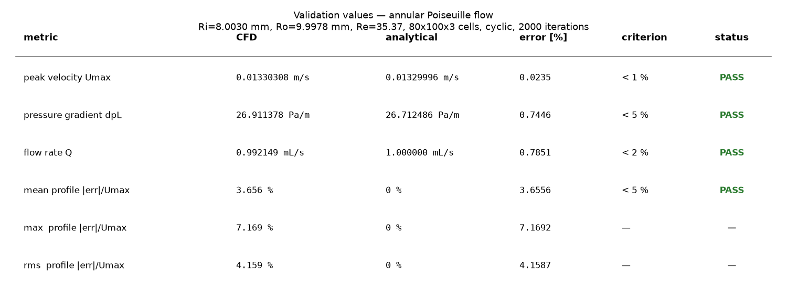
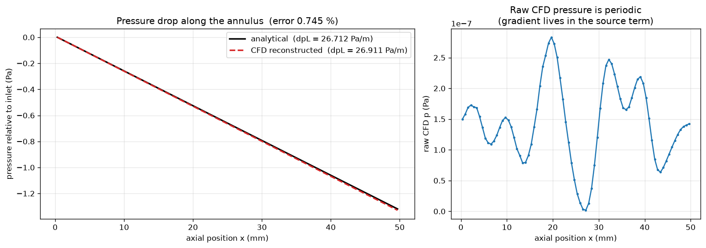

# SGK Mini

This is a small companion project of SGK — Space Generative Kernel (see the `sgk` repository). Its only job is to check, on a deliberately small case, that the technical stack the SGK pre-design relies on actually stands up, before investing engineering time in the full architecture.

The scope is intentionally narrow: a hollow cylinder, an analytical flow benchmark, and a CFD cross-check. Nothing here pretends to be more than that.

## Results at a glance

The validation compares OpenFOAM against the exact annular-Poiseuille
solution. The figures below are committed in the repository, so you can read
them without cloning or running anything.

**Values — CFD against analytical** (annulus Ri=8.00 mm, Ro=10.00 mm, Re≈35,
80×100×3 cells, 2000 iterations):



**Radial velocity profile** at three axial stations — the flow is fully
developed, so the profile is the same everywhere:


**Axial velocity field** on the meridional plane (CFD, analytical, and their
difference — the residual is the systematic near-wall finite-volume bias):


**Pressure drop** along the annulus (the raw CFD pressure is periodic because
the driving gradient lives in the `meanVelocityForce` source term; the linear
part is reconstructed with the solver's own gradient):



## What is in this repository

- `src/SGK.Geometry/` — the C# / .NET 9 project (the whole codebase).
- `SGK-Mini.sln` — solution file.
- `output/` — generated geometry and JSON records (gitignored).
- `validation/` — the reproducible validation: the OpenFOAM case (dictionary
  sources only), `validate_annulus.py`, `run_annulus.sh`, and the expected
  records. See `validation/README.md`.
- `scripts/check_analytic.py` — one-command analytical check (build, run,
  compare against `validation/expected/`).
- `cases/` — local, exploratory OpenFOAM cases and historical scripts used
  while developing the validation. Kept locally, outside the repository.

## The test case

| Parameter | Value |
|---|---|
| Nominal outer / inner diameter | 20 mm / 16 mm |
| Nominal length | 50 mm |
| Voxel size | 0.3 mm |
| Density | 1000 kg/m³ |
| Dynamic viscosity | 0.001 Pa·s |
| Volumetric flow rate | 1e-6 m³/s |
| Velocity profile samples | 17 radial locations, both walls included |
| Reynolds number | ≈ 35.4 |

The flow assumptions are steady, incompressible, Newtonian, laminar, fully
developed axial flow in a concentric annulus, with no-slip walls and entry and
exit effects neglected.

The analytical model does not use the nominal radii directly: it reconstructs an
equivalent annulus from the measured voxel volume and bounding box (area =
volume / length). The reconstruction is honest but not exact, so the radii it
works with differ slightly from the nominal ones — Ri = 8.0030 mm and
Ro = 9.9978 mm in the reference run, against a nominal 8 mm and 10 mm.

## Outputs

Everything generated lands in `output/`, which is gitignored:

| File | Contents |
|---|---|
| `hollow-cylinder.vdb` | voxel field, saved and reloaded for the round-trip check |
| `hollow-cylinder.features.json` | schema and case identifiers, volume, bounding box |
| `hollow-cylinder.physical-case.json` | reconstructed radii, fluid properties, mean velocity, Reynolds number, pressure gradient and drop, 17 velocity samples, wall shear stresses |

## Environment

- Omarchy 4.5 (Arch-based), native development environment.
- .NET 9 SDK.
- PicoGK 2.2.0 (NuGet package). PicoGK's native runtime has no official Linux
  binary; it is built from source (CMake + GCC, OpenVDB/GLFW/imgui via git
  submodules, system Blosc) and the resulting `picogk.so` is copied into the
  build output next to the symlink names the P/Invoke layer expects. This
  artifact is machine-specific and not versioned — it must be rebuilt on any
  new machine. See the `sgk-mini` notes in the vault for the exact procedure.
- OpenFOAM v2606 (core) for the CFD cross-check, available via its `etc/bashrc`.

## Build and run

```bash
dotnet run --project src/SGK.Geometry/ -- --auto-exit
```

Flags:

- `--auto-exit` — close the PicoGK viewer automatically when the task ends
  (needed for scripts/CI; without it the viewer stays open until closed).
- `--config <file.json>` — override the geometry, e.g.
  `{ "OuterRadiusMm": 12.0, "InnerRadiusMm": 9.0, "LengthMm": 40.0 }`.
  Defaults reproduce the validated 20/16 mm × 50 mm hollow cylinder.

Output always lands in the repository's `output/` directory, regardless of the
working directory the program is launched from.

## Reproduce the validation

```bash
./scripts/check_analytic.py          # build + run + compare (no OpenFOAM needed)
./scripts/check_analytic.py --with-cfd   # add the OpenFOAM cross-check
```

or, manually:

```bash
dotnet run --project src/SGK.Geometry/ -- --auto-exit
./validation/run_annulus.sh --check
```

## What has been validated

- PicoGK voxel geometry generation and round-trip serialization to `.vdb` on
  Linux / .NET 9, with the native runtime built from source.
- A minimal hollow-cylinder geometry (OD 20 mm, ID 16 mm, length 50 mm), with
  feature extraction and JSON round-tripping through two independent code paths
  (schema identity plus minimal numeric sanity checks).
- An analytical physics benchmark: steady, fully developed laminar axial water
  flow in a concentric annulus, with both global targets (mean velocity,
  Reynolds number, pressure gradient and drop) and local targets (velocity
  profile, maximum velocity, wall shear stress on both walls).
- OpenFOAM `simpleFoam` validated against that analytical benchmark on two
  geometric configurations:
  - narrow gap (Ri = 8 mm, Ro = 10 mm, Re ≈ 35);
  - wide gap (Ro = 30 mm, Re ≈ 17), as a sensitivity test.
  - Recommended mesh: cyclic periodic boundary conditions with
    `meanVelocityForce`, 80 × 100 × 3 cells, radial grading 1.5.
  - Results: peak velocity (Umax) error 0.023%, pressure-gradient error 0.74%,
    flow-rate error 0.79%, mean near-wall profile error 3.7% — as far as I can
    tell, the near-wall error is systematic and inherent to second-order
    finite-volume discretization at this aspect ratio, not an implementation
    defect.
- This validation is reproducible from the repository: the cyclic case lives in
  `validation/openfoam/annulus_cyclic/`, and `scripts/check_analytic.py`
  regenerates and checks the analytical records against committed expectations.

## What remains open

Three defects in the current implementation are known and not yet corrected.
They do not affect the CFD comparison numbers above, but they limit what the
program itself can claim.

- **Domain wording in the physical record.** `GeometryInterpretation` describes
  the hollow-cylinder voxel body as "the solid wall of a concentric annular flow
  passage", while the analytical model uses the annular ring itself as the fluid
  domain. The text needs correcting and the reconstructed radii need checking
  against the nominal inputs.
- **Sampled peak velocity.** `MaxVelocityMPerS` is the largest of the 17 sampled
  radial velocities, not the continuous analytical maximum. Peak-velocity error
  should be computed against the continuous maximum, or CFD and reference
  should be compared at matched sample locations.
- **Exit status.** Exceptions are printed but do not set a non-zero exit code,
  so exit code 0 alone does not prove the checks passed.
  `scripts/check_analytic.py` closes this gap by comparing the produced records
  against `validation/expected/`.

## What is missing

- The geometry is not yet consumed by the physics: the annular benchmark is
  reconstructed from scalar features (bbox + volume), not from the voxel field,
  and the CFD case is a hand-built annulus. The geometry→physics coupling is
  currently nominal.
- A dataset generator. The geometry is parameterizable, but nothing yet samples
  that parameterization into a dataset.
- A small (geometry, CFD field) dataset.
- A first tiny surrogate (PhysicsNeMo), with its inference accuracy and speed
  measured against the analytical and CFD ground truth.
- A minimal Layer 3 optimization loop.

## How this feeds SGK

The SGK pre-design describes four layers; only an embryo of Layer 1 exists, and it is here. If this validation slice holds, SGK proper starts from a small but complete problem — a liquid engine in blowdown mode, for example — and grows family by family. This repository stays as a validation record; what is learned here gets rewritten cleanly into `sgk`.
