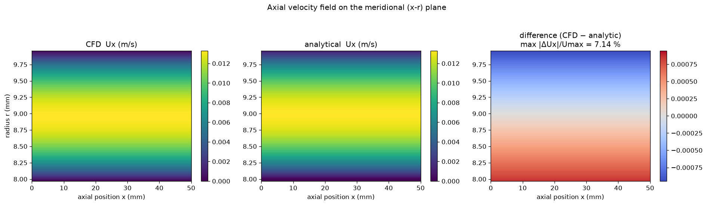

# SGK Mini

This is a small companion project of SGK — Space Generative Kernel (see the `sgk` repository). Its only job is to check, on a deliberately small case, that the technical stack the SGK pre-design relies on actually stands up, before investing engineering time in the full architecture.

The scope is intentionally narrow: a hollow cylinder, an analytical flow benchmark, and a CFD cross-check. Nothing here pretends to be more than that.

## Results at a glance

The validation compares OpenFOAM against the exact annular-Poiseuille
solution. The figures below are committed in the repository, so you can read
them without cloning or running anything.

**Values — CFD against analytical** (annulus Ri=8.00 mm, Ro=10.00 mm, Re≈35,
2° axisymmetric wedge, 58×100×1 cells, 8000 iterations):


**Radial velocity profile** at three axial stations — the flow is fully
developed, so the profile is the same everywhere:


**Axial velocity field** on the meridional plane (CFD, analytical, and their
difference — after comparing at consistent radii the residual is the remaining
discretisation error, and the earlier "inherent near-wall bias" reading is gone):



**Pressure drop** along the annulus (the raw CFD pressure is periodic because
the driving gradient lives in the `meanVelocityForce` source term; the linear
part is reconstructed with the solver's own gradient):


## What is in this repository

- `src/SGK.Geometry/` — the C# / .NET 9 project (the whole codebase).
- `SGK-Mini.sln` — solution file.
- `output/` — generated geometry and JSON records (gitignored).
- `validation/` — the reproducible validation: the OpenFOAM case (dictionary
  sources only), `validate_annulus.py`, `run_annulus.sh`, and the expected
  records. See `validation/README.md`.
- `scripts/check_analytic.py` — one-command analytical check (build, run,
  compare against `validation/expected/`).
- `scripts/voxel_resolution_curve.py` — measures the geometry stage at several
  voxel sizes (time, memory, volume convergence) and writes
  `validation/voxel-resolution-curve.md`.
- `docs/dataset-pipeline.md` — the plan for the dataset stage: pieces, acceptance
  criteria, failure policy, open decisions.
- `cases/` — local, exploratory OpenFOAM cases and historical scripts used
  while developing the validation. Kept locally, outside the repository.

## The test case

| Parameter | Value |
|---|---|
| Nominal outer / inner diameter | 20 mm / 16 mm |
| Nominal length | 50 mm |
| Voxel size | 0.2 mm |
| Density | 1000 kg/m³ |
| Dynamic viscosity | 0.001 Pa·s |
| Volumetric flow rate | 1e-6 m³/s |
| Velocity profile samples | 17 radial locations, both walls included |
| Reynolds number | ≈ 35.4 |

The flow assumptions are steady, incompressible, Newtonian, laminar, fully
developed axial flow in a concentric annulus, with no-slip walls and entry and
exit effects neglected.

The analytical model does not use the nominal radii directly: it reconstructs an
equivalent annulus from the measured voxel volume and bounding box (area =
volume / length). The reconstruction is honest but not exact, so the radii it
works with differ slightly from the nominal ones — Ri = 7.9993 mm and
Ro = 10.0000 mm in the reference run at 0.2 mm voxel, against a nominal 8 mm and
10 mm. The residual is 0.7 µm, about 0.004 voxel.

## Outputs

By default everything generated lands in `output/`, which is gitignored. The
file names use the case id, so a configured case writes
`<case-id>.vdb`, `<case-id>.features.json` and `<case-id>.physical-case.json`:

| File | Contents |
|---|---|
| `hollow-cylinder.vdb` | voxel field, saved and reloaded for the round-trip check |
| `hollow-cylinder.features.json` | schema, case id, voxel size, volume, bounding box |
| `hollow-cylinder.physical-case.json` | reconstructed radii, fluid properties, mean velocity, Reynolds number, pressure gradient and drop, 17 velocity samples, continuous and sampled peak velocity, signed wall shear stresses |

## Environment

- Omarchy 4.5 (Arch-based), native development environment.
- .NET 9 SDK.
- PicoGK 2.2.0 (NuGet package). PicoGK's native runtime has no official Linux
  binary; it is built from source (CMake + GCC, OpenVDB/GLFW/imgui via git
  submodules, system Blosc) and the resulting `picogk.so` is copied into the
  build output next to the symlink names the P/Invoke layer expects. This
  artifact is machine-specific and not versioned — it must be rebuilt on any
  new machine. See the `sgk-mini` notes in the vault for the exact procedure.
- OpenFOAM v2606 (core) for the CFD cross-check, available via its `etc/bashrc`.
- numpy for the validation, and matplotlib for the committed figures. matplotlib
  is a plotting-only dependency: the numerical checks run without it.

## Build and run

```bash
dotnet run --project src/SGK.Geometry/ -- --auto-exit
```

Flags:

- `--auto-exit` — close the PicoGK viewer automatically when the task ends
  (needed for scripts/CI; without it the viewer stays open until closed).
- `--config <file.json>` — override the case inputs, e.g.
  `{ "CaseId": "ann-001", "OuterRadiusMm": 12.0, "InnerRadiusMm": 9.0,
  "LengthMm": 40.0, "VoxelSizeMm": 0.2, "VolumetricFlowRateM3PerS": 2e-6,
  "OutputDirectory": "/home/you/data/datasets/sgk-mini/ann-001" }`.
  Defaults reproduce the validated 20/16 mm × 50 mm hollow cylinder at 0.2 mm
  voxel. Unknown properties are rejected; a misspelled field is an error, not a
  silent default. `VoxelSizeMm` is a case parameter because it bounds which
  features the geometry can represent: a feature needs a few voxels across to be
  honest, so at 0.2 mm nothing below about 0.6 mm is resolved. See
  `validation/voxel-resolution-curve.md` for the measured trade-off.

Without `OutputDirectory`, output lands in the repository's `output/` directory,
regardless of the working directory the program is launched from.

## Read-only workbench

The local workbench shows the batch, VDB geometry, CFD profiles, checks, logs
and source history. See the [launch command and artifact interface](workbench/README.md).

## Layer 2 experiments

See the [training stages](training/README.md) and
[screening protocol](training/protocol.md) for the runnable parameter baseline.
Its run artifacts are visible in the local workbench.

## Reproduce the validation

```bash
./scripts/check_analytic.py          # build + run + compare (no OpenFOAM needed)
./scripts/check_analytic.py --with-cfd   # add the OpenFOAM cross-check
```

or, manually:

```bash
dotnet run --project src/SGK.Geometry/ -- --auto-exit
./validation/run_annulus.sh --check
```

## What has been validated

- PicoGK voxel geometry generation and round-trip serialization to `.vdb` on
  Linux / .NET 9, with the native runtime built from source.
- A minimal hollow-cylinder geometry (OD 20 mm, ID 16 mm, length 50 mm), with
  feature extraction and JSON round-tripping through two independent code paths
  (schema identity plus minimal numeric sanity checks).
- An analytical physics benchmark: steady, fully developed laminar axial water
  flow in a concentric annulus, with both global targets (mean velocity,
  Reynolds number, pressure gradient and drop) and local targets (velocity
  profile, maximum velocity, wall shear stress on both walls).
- OpenFOAM `simpleFoam` validated against that analytical benchmark on the
  committed reference case:
  - narrow gap (Ri = 8 mm, Ro = 10 mm, Re ≈ 35);
  - a wider-gap sensitivity run (Ro = 30 mm, Re ≈ 17) was done locally during
    development but is not part of the versioned, reproducible suite.
  - Recommended mesh: 2° axisymmetric wedge with one tangential cell, axial
    cyclicity, 80 × 100 × 1 cells, radial grading 1.5.
  - Results at 0.2 mm voxel: peak velocity (Umax) error 0.010%,
    pressure-gradient error 0.0095%, flow-rate error 0.0203%, mean profile error
    0.0046% and maximum 0.0071%. The flow-rate error is the measured geometric
    defect of the finite wedge: its end faces are polygons with
    sin(2°)/2° = 0.0203% less area than the annulus.
  - Every literal connection between the record and the solver is checked before
    the mesh is built: radii, length, kinematic viscosity, the full imposed mean
    velocity vector and the case identity. `validation/test_guards.py` breaks
    each one on purpose and requires rejection. They were added after a stale
    `Ubar` produced a 0.29% shift in every metric that looked like a physics
    regression.
- This validation is reproducible from the repository: the cyclic case lives in
  `validation/openfoam/annulus_cyclic/`, and `scripts/check_analytic.py`
  regenerates and checks the analytical records against committed expectations.

## What was corrected on 2026-11-17

Three defects previously listed here are closed, and the physical record schema
moved to `sgk-mini.physical-record.v3` to mark the change (v2 added the split
between continuous and sampled peak; v3 adds the fluid/flow inputs, the voxel
size and the shear sign convention):

- **Domain wording.** `GeometryInterpretation` no longer calls the voxel body
  "the solid wall of the annular flow passage". It now states what the code
  actually does: the voxel body is the wall material between the inner and outer
  radius, its volume and bounding box are used only to recover those radii, and
  the fluid domain is the annular space between them. No fluid region is
  extracted from the geometry.
- **Peak velocity.** `MaxVelocityMPerS` is now the continuous analytical maximum,
  evaluated where `du/dr = 0`, instead of the largest of the 17 profile samples.
  The sampled value is still recorded, as `SampledMaxVelocityMPerS` and
  `SampledMaxVelocityRadiusMm`, and the record validator asserts that it cannot
  exceed the continuous maximum. This moved the peak-velocity error against CFD
  from 0.023 % to 0.011 %.
- **Exit status.** A failure now exits non-zero. Exceptions raised inside the
  PicoGK task thread are captured there, since an exception escaping that thread
  is not guaranteed to reach the outer handler. Verified on two paths: a geometry
  smaller than one voxel (`Invalid volume: 0`) and an invalid `--config`.

## What was corrected on 2026-11-18

An independent audit of the validation found four defects that a passing check
could not see. Each is fixed and has a focused negative test:

- **A NaN field passed.** Replacing the velocities with NaN produced five NaN
  metrics and `CHECK PASSED`, exit 0. Non-finite inputs, fields and metrics are
  now rejected before any tolerance is evaluated.
- **The profile was compared outside its domain.** The innermost cell centre is
  at `r·cos(5°)`, inside the ideal wall, so the analytical solution was being
  extrapolated. Comparing at the radial face radius changed the mean/max profile
  error from 3.64/7.15 % to 0.0046/0.0071 %. The claim that 3.6 % was inherent
  second-order error was wrong and has been removed everywhere.
- **The flow was integrated with invented edges.** The old estimator put its
  first and last edges at cell centres and used one angular layer; it reported
  0.7845 %. The native patch flux gave the same field 0.5069 %, and the gap was
  the estimator. The validator now uses the mesh cell volumes and OpenFOAM's own
  fluxes, and reports signed flux, conservation, area defect and field integral
  separately.
- **Convergence was never checked.** Reaching `endTime` was treated as success.
  The validator now records residuals, iterations, stopping reason, continuity,
  absolute transverse velocity and the stability of `dpL`, `Q` and `Umax`. The
  pressure residual is qualified rather than blindly required: in this periodic
  case `p` is ~1e-15, so its normalised residual divides by a near-zero
  denominator. The evidence is in `docs/pilot-checks.md`.

The reference case is now a 2° axisymmetric wedge in one tangential cell instead
of a 30° section in three. Its area defect is 0.0203 % instead of 0.507 %, and
the flow-rate label carries only that measured defect.

The reference uses bounded `linearUpwind` and sets the axial resolution from
case length and radial pitch. The eight-case Latin hypercube and a separate
stress test at reconstructed Re = 1989.7 passed the existing checks. See the
[Reynolds convergence report](pipeline/reports/reynolds-readiness.md).

## What remains open

- The reconstructed radii still differ from the nominal ones by 0.7 µm at
  0.2 mm voxel. That residual is the discretisation of the representation, and
  it is reported rather than corrected.
- The remaining profile error (0.0046 % mean, 0.0071 % max) is measured on one
  radial mesh. Angular and radial refinement have not been separated, so the
  split between discretisation and extraction is not yet measured.
- The wedge still has a finite angular area defect of 0.0203 %. It is measured
  and accepted as the label's geometric bias; it is not corrected away by
  rescaling the area.

## What is missing

See the [current state and handoff](docs/sgk-mini-status.md) before resuming
dataset or model work.

- The geometry is not yet consumed by the physics: the annular benchmark is
  reconstructed from scalar features (bbox + volume), not from the voxel field,
  and the CFD case is built from those scalars. The geometry→physics coupling is
  currently nominal.
- Layer 2 training and evaluation. The CFD batch has 20 accepted cases.
  All 20 have geometry and CFD arrays prepared in a common frame with
  recorded normalization. See the [batch report](pipeline/reports/batch-v1.md)
  and [conversion commands](pipeline/README.md#prepared-model-inputs).
- A first tiny surrogate (PhysicsNeMo), with its inference accuracy and speed
  measured against the analytical and CFD ground truth.
- A minimal Layer 3 optimization loop.

## Planned: dataset and surrogate validation

Everything below is **planned, not implemented**, except where it points to the
pilot report. It exists here so the target is written down before the work
starts, and so the acceptance criteria cannot be chosen after seeing the results.
The eight-case pilot exercised the geometry, reference, record and quality pieces
and is reported in `pipeline/reports/pilot-report.md`.

### What is being validated

Seven boundaries, each with a test that can fail. A boundary that is not tested
is a claim, not a capability.

| # | Boundary | Acceptance criterion |
|---|---|---|
| 1 | voxel geometry → CFD mesh | the mesh reproduces the voxel volume and radii within a declared tolerance, and the difference is explained by snapping and grading; a full CFD case runs from the geometry alone |
| 2 | CFD → dataset | every run stores residuals, iterations, mass balance and the analytical cross-check; failed runs are kept but never used as labels |
| 3 | geometry → model input | one converter for training and inference; the distance-field round trip is verified; normalization is saved with the model |
| 4 | model → physics | errors on engineering quantities and on the field, on geometries held out of training, reported alongside the loss |
| 5 | model → search | every selected candidate is recomputed with the reference solver; predicted versus reference is reported |
| 6 | geometry → printable artifact | watertight solid, declared minimum wall and channel respected, voxel resolution sufficient for the features claimed |
| 7 | results → conclusions | the metrics are read against written criteria, and the remaining reference error (measured at 0.005 % mean / 0.007 % max on the profile after correcting the comparison radius) is separated from model error |

### Target and baselines

The **field** is the real target: predicting the velocity map over the passage,
not only the two integrated numbers. Engineering quantities (pressure gradient,
peak velocity) stay as a minimum score every model must pass, and as a cheap
reference.

Three models are compared on identical splits, and the comparison has a declared
purpose:

- a **parameter-only regressor** — not a rival, but a threshold: it tells how
  much of the error is irreducible on this family of shapes;
- a **fixed-grid operator** — the cheap operator baseline;
- a **geometry-aware model** — the candidate, certified rather than ranked.

### Certification of the geometry-aware model

On this case the exact answer is known, so the model is checked, not just scored:

- **accuracy** against the analytical and CFD references;
- **invariance**: the same case described differently (shifted origin, rotated
  axis, denser surface sampling) must give the same answer;
- **mass balance**: the predicted velocity field must integrate to the imposed
  flow rate;
- **domain edges**: thin gaps, high eccentricity and out-of-range parameters must
  degrade predictably, not explode.

Before any of these is trusted, the checks themselves are broken on purpose: an
injected error must be detected. A check that cannot fail proves nothing.

### Resolution rule

The voxel size is a case parameter, not a constant, and the default is 0.2 mm.
A feature is represented honestly only at a few voxels across; at 0.2 mm,
features below about 0.6 mm are not resolvable. The dataset bounds must respect
that rule, and the coarse/fine resolution split (search versus final
verification) follows from it.

### What this stage will not claim

- It will not show that geometry matters. On a full engine that is already given;
  the annular case cannot demonstrate it.
- It will not show that a learned model replaces the reference solver. Only that
  it approximates it within a measured error and a measured cost.
- It will not judge a design search on speed alone: benefit is measured at
  comparable design quality.

## How this feeds SGK

The SGK pre-design describes four layers; only an embryo of Layer 1 exists, and it is here. If this validation slice holds, SGK proper starts from a small but complete problem — a liquid engine in blowdown mode, for example — and grows family by family. This repository stays as a validation record; what is learned here gets rewritten cleanly into `sgk`.
